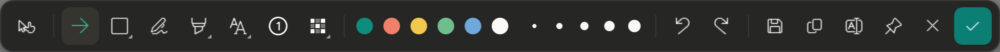
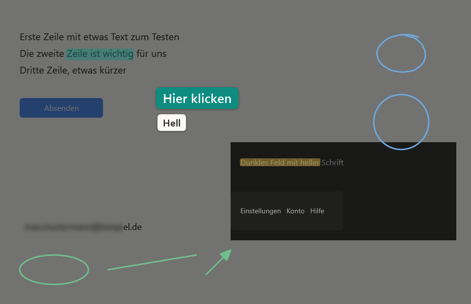
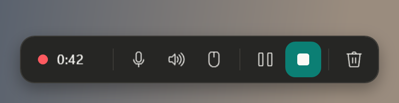
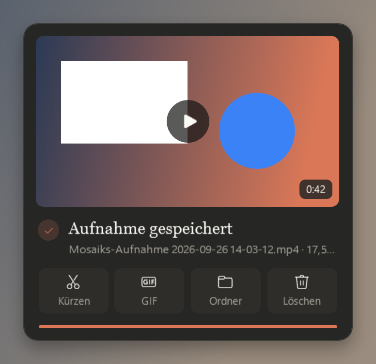
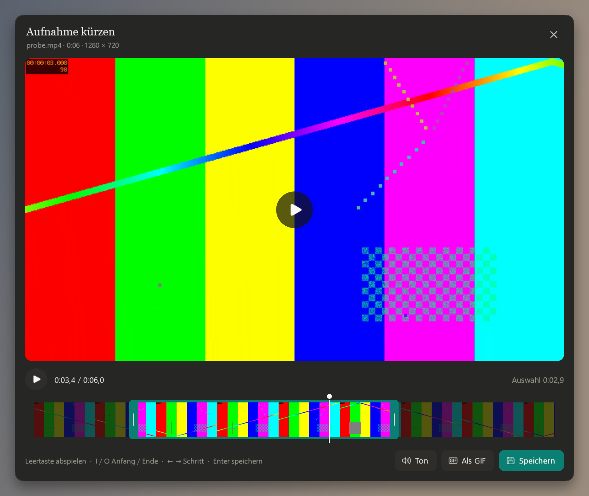
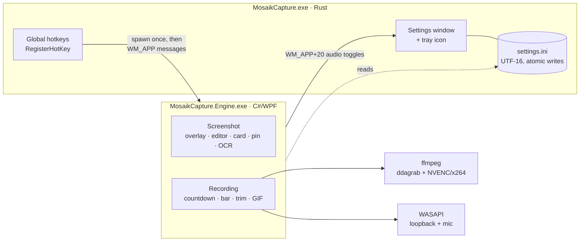

<div align="center">

# Mosaik Capture

**A fast, keyboard-first screenshot and screen-recording tool for Windows,
built as a small Rust tray app driving a C#/WPF capture engine.**

[](https://github.com/Mosaik114/mosaik-capture/actions/workflows/ci.yml)
[](https://github.com/Mosaik114/mosaik-capture/actions/workflows/secrets.yml)


[](LICENSE)



</div>

Press **Shift+Alt+4**, drag an area, and the screenshot is already on the clipboard and
saved as PNG. A card offers editing, pinning and text recognition. **Shift+Alt+5** does the
same for screen recordings: GPU-accelerated capture with system sound and microphone,
pause/resume, trimming and GIF export.

> The user interface is in German (the author's daily driver); code, docs and commit
> history are in English.

## Highlights

| | |
|---|---|
| **Instant capture** | The screen is frozen first, so menus and tooltips stay put. Drag an area, click a window, or press Space for the whole monitor. A magnifier shows the pixels under the cursor. Spans all monitors, including very wide virtual screens such as 5120 × 1440. |
| **Annotation editor** | Arrows, rectangles, ellipses, lines, pen, highlighter, spotlight, text (plain or on a plate), numbered steps, pixelate and blur. Hold the pen still and a rough stroke snaps into a clean line, arrow, ellipse, rectangle, triangle or rhombus; the highlighter snaps to text lines and word boundaries. |
| **Offline text recognition** | `Ctrl+Shift+C` copies the text in the capture using the on-device Windows OCR engine — nothing leaves the machine. |
| **Pin to screen** | Keep a capture floating above other windows as a reference. |
| **Screen recording** | Desktop Duplication through ffmpeg's `ddagrab` on the GPU, NVENC with automatic x264 fallback, 30 or 60 fps. System sound (WASAPI loopback) and microphone are recorded as separate tracks and stay in sync across pauses. |
| **Trim & GIF** | A film-strip trimmer (`Space` play, `I`/`O` in/out, arrow keys step) exports MP4 or GIF. |
| **Tiny footprint** | A ~280 KB tray app with no runtime dependencies (CI prints the size of every release build); the engine starts on the first capture and stays resident. No network access, no telemetry, no elevation. |

<p align="center">
  
</p>

<p align="center">
  
  &nbsp;
  
</p>

<p align="center">
  
</p>

<sub>These images are reference renders from the pixel-comparison test suite, drawn
off-screen by the real WPF code.</sub>

## Architecture



**Why two languages?** The always-running part should cost nothing: the Rust host is a
small native Win32 app that registers hotkeys, owns the settings and autostart, and
otherwise sleeps in its message loop. Everything visual — the freeze-frame overlay, the
editor with its shape recognition, the recording UI — lives in WPF, which is still a very
productive way to build rich, high-DPI desktop UI on Windows. The engine is started on the
first capture and then stays resident, so later captures open instantly.

The two processes talk only through window messages and session-local mutexes; the
contract (message numbers, class names, command-line flags) is pinned by tests on both
sides. Details — the recording pipeline, the testing strategy, what is deliberately not
tested, and three engineering problems and how they were solved — are in
[docs/architecture.md](docs/architecture.md).

## Install

1. Download `mosaik-capture-<version>-win-x64.zip` from the
   [latest release](https://github.com/Mosaik114/mosaik-capture/releases/latest) and unzip
   both executables into one folder.
2. Start `MosaikCapture.exe`. It adds itself to the tray and (by default) to autostart.
3. For screen recording, install ffmpeg: `winget install Gyan.FFmpeg.Essentials`.

Requirements: Windows 10/11 x64 with .NET Framework 4.8 (built into current Windows).
The executables are not code-signed, so Windows SmartScreen may warn on first start, and
with *Smart App Control* enabled Windows refuses to run them.

## Usage

| Shortcut | Action |
|---|---|
| `Shift+Alt+4` | Screenshot: drag an area, click a window, or `Space` for the whole monitor |
| `Shift+Alt+5` | Start recording (area, window or `Space`); press again to stop |
| `Esc` | Cancel selection or countdown |
| `V A R E L P M S T B N X W` | Editor tools: move, arrow, rectangle, ellipse, line, pen, marker, spotlight, text, text plate, number, pixelate, blur |
| `Ctrl+Shift+C` | Recognise and copy text (editor) |
| `Space` · `I` / `O` · `←` `→` | Trim window: play, set in/out, step |

Shortcuts, folders, microphone, system sound, click display, frame rate, countdown and
autostart are configured in the settings window (tray icon → *Einstellungen*). A custom
shortcut is one key (letter, digit, Space or F1–F24) plus Ctrl or Alt, optionally with Shift,
so it can never swallow normal typing.
Settings live in `%LOCALAPPDATA%\MosaikCapture\settings.ini`. By default screenshots go to
`Pictures\Mosaiks-Screenshots` and recordings to `Videos\Mosaiks-Aufnahmen` — user-facing
names, so they follow the German UI (as do output file names like
`Mosaiks-Aufnahme 2026-09-26 14-03-12.mp4`); both folders can be changed in the settings.

## Build from source

Prerequisites: [Rust](https://rustup.rs) (stable) and the [.NET SDK 10](https://dotnet.microsoft.com/download).

```powershell
./build.ps1 -Test      # builds both programs into bin\ and runs the Rust and C# test suites
./build.ps1 -Package   # additionally zips the executables into dist\
```

Without Visual Studio's MSVC linker the script builds the Rust part with the
`stable-x86_64-pc-windows-gnu` toolchain; `build.rs` embeds icon, manifest and version info
without external resource tools, so both toolchains produce the same resources.

## Quality

| Check | Rust host | C# engine |
|---|---|---|
| Tests | 109 unit tests (hotkeys, settings, migration, CLI, forwarding, DPI, atomic writes, resource writer) + an end-to-end test that drives the real settings window | 394 xUnit cases: the recording and screenshot state machines with fakes (incl. recovery from UI errors), ffmpeg timeouts and cancellation, WASAPI padding/trimming, shape recognition, highlighter snapping, command-line quoting, real-ffmpeg trim/GIF/audio-sync runs, IPC contract, pixel comparisons of 13 UI states |
| Static analysis | `clippy::pedantic`, warnings as errors, every `unsafe` block carries a `// SAFETY:` note | Nullable reference types, .NET analyzers (`Recommended`), warnings as errors |
| Formatting | `cargo fmt --check` | `dotnet format --verify-no-changes` |
| Supply chain | `Cargo.lock`, a single dependency (`windows-sys`) | Central package management, `packages.lock.json`, locked restore |

CI runs every one of these suites on `windows-latest` for each push — including the window
end-to-end test and the real ffmpeg runs. The pixel tests run too, with a blur-tolerant
comparison because the runner's fonts differ slightly, and skip with a named reason if a
reference font is missing there. CI also prints the binary size, builds the release zip and
attaches it to tagged releases. Actions are pinned to commit SHAs, Dependabot watches Cargo,
NuGet and Actions, and gitleaks scans the full history on every push and weekly.

## Design decisions and trade-offs

- **Two processes instead of one.** Hotkeys must work even while the editor is busy or has
  crashed, and the always-on part should cost almost nothing. The price is an IPC contract,
  which is why both sides pin it in tests.
- **WPF on .NET Framework 4.8, not .NET 8+.** 4.8 ships with Windows, so users need no
  runtime and the engine stays a ~290 KB executable. Moving to .NET 8 would bring faster
  startup and newer APIs at the cost of a runtime install or a ~150 MB self-contained build.
- **ffmpeg as an external tool.** Desktop Duplication, NVENC and robust muxing come for free;
  the engine only has to drive it carefully (absolute local paths, a job object, one encoder
  per session, exact segment timing).
- **Own WASAPI capture instead of ffmpeg's audio inputs.** Keeping system sound and microphone
  on separate tracks with device timestamps is what makes pause/resume stay in sync.
- **A hand-written resource writer in `build.rs`.** It avoids requiring `rc.exe`/`windres`
  on contributors' machines; the cost — a bit of binary-format code — is paid back by
  golden-layout tests.
- **Next steps:** code-sign the binaries, add an installer (winget manifest), and
  move the editor's UI construction from code into XAML resources to shorten the largest files.

## Project layout

```
src/                 Rust tray app
  main.rs            entry point, exit codes
  cli.rs             command-line parsing
  single_instance.rs mutex and forwarding to the running instance
  hotkey.rs          "Shift+Alt+4" → RegisterHotKey (German and English key names)
  config.rs          settings model, defaults, validation (pure, unit-tested)
  store.rs           settings.ini I/O with atomic replace and migration
  autostart.rs       per-user Run value
  engine.rs, ipc.rs  launching and messaging the capture engine
  ui/                settings window, tray icon, theme, DPI-aware layout, folder picker
build.rs, build/     embeds icon, manifest and version info (tested resource writer)
engine/              C#/WPF capture engine (net48)
  Core/              entry point, IPC bridge, settings, error log, NativeMethods, UiText
  Screenshot/        grabber, overlay, editor (shapes, markup, mouse, result), card, pin, OCR
  Recording/         controller + interfaces, session, ffmpeg + argument builder, WASAPI, trim
tests/               xUnit test project incl. reference images
docs/                architecture notes and images
```

## How it was built

This started as a personal tool that I use every day. This repository was created on
2026-11-12: the first commit imports that tool unchanged, and the following commits are a
deliberate restructuring for publication — modular Rust, an SDK-style C# project, tests,
CI — done in several rounds of independent AI-assisted code review whose findings were fixed
and verified by the test suites. Further changes go through pull requests with CI.

It was developed with AI coding assistants (OpenAI Codex, Anthropic Claude) as pair
programmers; requirements, design decisions, review and day-to-day testing are the author's.

## License

[MIT](LICENSE) © 2026 Mazgin Abdulwahed Ahmad
